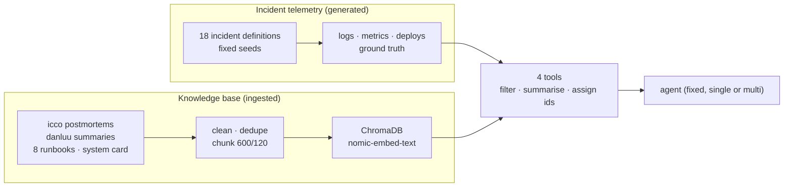

# Data Processing

Incident Triage Copilot · Sharad Cornejo Altuzar · Capstone project, AI Engineering cohort (RAG & Agents)

Companion documents: [Problem Definition](problem-definition.md) · [Evaluation Criteria](evaluation-criteria.md) · [System Design](design-doc.md) · [Results site](https://krolth.github.io/incident-copilot/)

Two kinds of data feed the agents: the **incident telemetry** they investigate, and the **knowledge base** they
retrieve from. Both are processed the same way for every design, so the data cannot favour one over another.



## 1. Incident telemetry (generated, deterministic)

Each of the 18 incidents is code (`triage/scenarios/defs.py`) that generates its data from fixed seeds, so every run
of every design sees exactly the same logs and numbers.

| Data | Volume | How it is made |
|---|---|---|
| Logs | 660 to 5,581 lines per incident, 41,663 in all, covering 3 to 6 hours before the alert | routine traffic from every involved service, plus the lines that carry the evidence; each line has a time, service, host, level, message and id |
| Metrics | 15 to 25 series per incident, 326 in all, readable from 15 minutes to 7 days back | a baseline plus deterministic noise (and a daily wave on load-driven series such as CPU and request rate), plus the incident's effects as steps, ramps and spikes |
| Changes | 26 deploys across the 18 incidents | the real trigger where there is one, and unrelated deploys as distractors; config pushes appear only in the `config-agent` log, as on the real platform |
| Ground truth | one per incident | category, runbook, reference action and the key evidence items, written before any model ran |

Every incident has a code fingerprint, recorded in each results folder, so results produced before a scenario change
are detectable as stale. Ground truth was frozen once real results existed.

## 2. From raw data to tool output

The tools turn raw data into what an on-call engineer would see, and give everything a stable id so answers can
cite it:

- **`search_logs`** filters by service, level, keyword and window (15m, 1h, 6h, 24h or 7d). It shows at most 20 matching
  lines and summarises the rest: count by level, top hosts, and a count histogram over the window that starts at log
  retention, so missing data shows up as a gap instead of as zeros.
- **`get_metrics`** returns min, max, mean and the last value, plus 12 evenly spaced points across the window.
- **`get_recent_deploys`** lists the changes in the window.
- **`search_knowledge`** returns the top 4 chunks, up to 700 characters each.

| Evidence | Id format | Example |
|---|---|---|
| log line | `L` + number | `L0868` |
| metric series | `M:service:metric:window` | `M:chess-db:cpu_pct:1h` |
| deploy | `D` + number | `D2` |
| knowledge chunk | `K:document#chunk` | `K:RB-01#2` |

Every id a tool returns is recorded per run. Citation validity is checked against that record, so an answer can only
cite what its agent actually saw.

## 3. Knowledge base (ingested, then indexed)

1. **Fetch.** `ingest/fetch_icco.py` copies the 242 postmortems of [icco/postmortems](https://github.com/icco/postmortems)
   (Markdown with YAML front matter). `ingest/fetch_danluu.py` parses the [danluu/post-mortems](https://github.com/danluu/post-mortems)
   list into 240 short categorised summaries. Both go to `corpus/`, which is git-ignored: the text belongs to its authors.
2. **Load and clean.** Front matter (company, categories, URL) becomes metadata. The two sources overlap, so documents are
   deduplicated by URL, keeping icco's full text: 318 postmortems remain. The 8 runbooks and sections 1 to 12 of the system
   card (`docs/system.md`) are added; its status notes and diagram are dropped. The scenario answer key
   (`docs/scenario-plan.md`) is excluded by design, and a test fails if it is ever loaded.
3. **Chunk.** Recursive character splitting, 600 characters with 120 overlap: 1,266 chunks (46 runbook, 29 system card,
   1,191 postmortem).
4. **Embed and store.** `nomic-embed-text` embeddings (via Ollama) in a local ChromaDB collection; each chunk keeps its
   source id and kind (runbook, system or postmortem).
5. **Check.** 25 labeled diagnosis-style queries (what an agent searches once it suspects a cause) measure retrieval. Chunk
   size and k were chosen on them:

| Configuration | hit@1 | hit@4 | MRR |
|---|---|---|---|
| 600-character chunks, no system card | 0.60 | 0.84 | 0.727 |
| **600-character chunks, with system card (chosen)** | **0.52** | **0.84** | **0.670** |

Section-based chunking of the runbooks was also tried and found the right document less often (hit@4 0.76), so it was
dropped. Adding the system card costs some rank-1 hits but gives the agents the platform's dependencies, which no other
source has. Queries phrased as the alert's symptom are much harder (hit@4 0.40 on 15 queries), which is why the agents
are expected to search again once they suspect a cause.

## Reproducing it

```
python ingest/fetch_icco.py && python ingest/fetch_danluu.py      # corpus -> corpus/ (git-ignored)
python -m triage.knowledge.index                                  # chunk, embed, store -> chroma_db/
python -m triage.evals.retrieval_eval --k 4 --diagnosis           # retrieval check on the labeled queries
```

The incident data needs no step: it is generated in memory each time a scenario is loaded.
