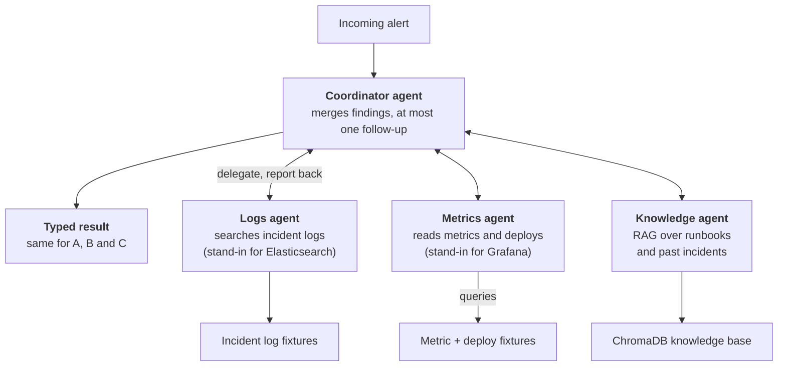

# Incident Triage Copilot: Single-Agent vs Multi-Agent

Oct 24, 2026 · @Sharad Cornejo Altuzar

## Problem Statement

Given one automated alert from a simulated live-service platform, the system names the root cause, recommends the matching runbook action, and says "insufficient evidence" when the data cannot support a conclusion, all before a human is paged.

- **Input:** one alert (for example, "matchmaking p99 latency above 2s") plus tool access to mock logs, metrics, deploy history, and a knowledge base of runbooks and past incidents.
- **Output:** a structured result with the root-cause category and failing component, cited evidence, a recommended action, and an "insufficient evidence" option.
- **Root-cause categories (6):** bad deploy or config change; dependency saturation or retry storm; resource leak; traffic spike beyond capacity; node or infrastructure failure; expired certificate or credential.
- **Scenarios:** 18 hand-built incidents with known root causes, all on one fictional system (an online chess platform, `docs/system.md`): 15 answerable and 3 where the correct answer is "insufficient evidence". They come in three difficulty tiers of 6: easy (the obvious read is right), medium (one natural coincidence, such as an unrelated deploy) and hard (real misdirection, or the right answer is to abstain). Ground truth is the mitigation to apply now. All scenario data is synthetic and labeled as such.

**Research question:** does a coordinator with specialist agents (logs, metrics, knowledge) beat a single agent with the same tools on root-cause accuracy, and what does it cost in tokens, latency, and dollars?

## Architecture

All three approaches share one data surface and one output schema, so the only variable under test is the control flow.

**Data surface**

- **Knowledge base (RAG):** public postmortems from [icco/postmortems](https://github.com/icco/postmortems) (242 full-text documents with metadata) and [danluu/post-mortems](https://github.com/danluu/post-mortems) (about 240 categorized summaries) act as past incidents. 8 invented runbooks, covering the seven root-cause categories (infra failure has two: a bad node, and DNS, network or provider), supply the recommended actions, and the platform's system card (`docs/system.md`: services, dependencies, what is stateful) is indexed with them. The scenario answer key is never indexed.
- **Mock tools:** `search_logs`, `get_metrics`, and `get_recent_deploys`, served from per-incident fixtures behind the interface a real Elasticsearch or Grafana client would expose.

**Ingestion and retrieval.** Front matter (company, categories) is kept as chunk metadata. Documents are chunked with overlap, embedded into ChromaDB, and deduplicated across the two sources by URL. Retrieval returns top-k chunks with source ids so every claim can be cited. Chunk size and k are chosen by hit rate on a small labeled set of diagnosis-style queries (what an agent searches once it suspects a cause), because most alerts describe a symptom that does not name the cause.

**Approaches compared**

1. **A. Fixed pipeline (baseline):** always retrieve top-k, pull a standard window of logs and metrics for the alerting service, and make one LLM call. No decisions by the model about what to look at.
2. **B. Single ReAct agent:** one LLM holding all four tools (knowledge search, logs, metrics, deploys) that decides what to call, with a step cap.
3. **C. Multi-agent:** a coordinator delegates to a logs agent, a metrics agent, and a knowledge agent, each holding only its own tools, with deploy history given to the metrics agent. The coordinator merges their structured findings, may request one follow-up round, and writes the final answer.

All three return the same typed result, so scoring does not depend on the approach.

**A coordinator delegates to three specialist agents**

*Approach C · coordinator + 3 specialists*

Approach B is this picture with the coordinator and workers collapsed into one agent holding all tools; approach A replaces the agents with a fixed sequence and a single LLM call.

## Framework Justification

- **LangGraph** runs approaches B and C. They then differ only in graph shape, and step limits are built in. Rejected: Pydantic AI (one framework for both B and C keeps the comparison clean) and smolagents (agents act by writing code, which changes the action model and needs sandboxing).
- **Pydantic** types the output for all three approaches, so scoring does not depend on parsing free text. Output that fails validation counts as a failed run.
- **ChromaDB via LangChain** is local, needs no server, and fits about 500 documents.
- **Models:** one model drives every agent (API or local, behind a provider-neutral interface), so control flow is the only variable. A different model judges, to reduce self-preference bias. Each run is saved as a plain JSON trace for token, cost and failure analysis.

Out of scope: live Elasticsearch, Grafana or chat-ops integrations, and real company data.

## Evaluation Criteria

Each approach runs all 18 incidents three times, so run-to-run variance is reported, and results are also broken down by difficulty tier. Judge scores are validated against about 20 of my hand labels and used only if agreement is strong; failed runs are read in full and classified in the README.

| Metric | How it is measured | Type |
| --- | --- | --- |
| Root-cause accuracy | Predicted category and failing component match the ground truth | Quantitative |
| Action correctness | LLM judge compares the recommended action to the reference runbook step | LLM judge |
| Citation validity | Every cited log line, metric, or document exists and supports the claim | Quantitative + judge |
| Abstention correctness | Says "insufficient evidence" on the 2 unanswerable incidents and not on the others | Quantitative |
| Tokens, cost (USD), latency, tool calls | Logged per run from the run trace | Quantitative |
| Retrieval hit rate | Expected runbook appears in the top-k when searching with each answerable incident's alert (what the fixed pipeline retrieves), and for the labeled diagnosis queries (used to choose chunk size and k) | Quantitative |
