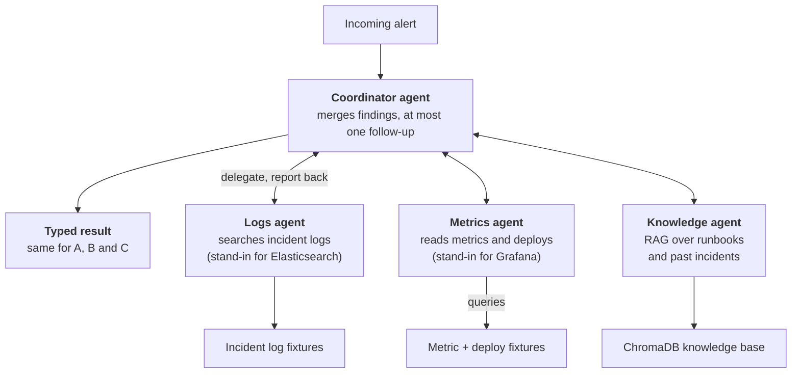

# Incident Triage Copilot: Single-Agent vs Multi-Agent

Oct 24, 2026 · @Sharad Cornejo Altuzar · updated Oct 30, 2026 with the decisions made during implementation

Results and a replay of every run: [krolth.github.io/incident-copilot](https://krolth.github.io/incident-copilot/)

## Problem Statement

Given one automated alert from a simulated live-service platform, the system names the root cause, recommends the matching runbook action, and says "insufficient evidence" when the data cannot support a conclusion, all before a human is paged.

- **Input:** one alert (for example, "matchmaking p99 latency above 2s") plus tool access to mock logs, metrics, deploy history, and a knowledge base of runbooks and past incidents.
- **Output:** a structured result with the root-cause category and failing component, cited evidence, a recommended action, and an "insufficient evidence" option.
- **Root-cause categories (6):** bad deploy or config change; dependency saturation or retry storm; resource leak; traffic spike beyond capacity; node or infrastructure failure; expired certificate or credential.
- **Scenarios:** 18 hand-built incidents with known root causes, all on one fictional system (an online chess platform, `docs/system.md`): 15 answerable and 3 where the correct answer is "insufficient evidence". They come in three difficulty tiers of 6: easy (the obvious read is right), medium (one natural coincidence, such as an unrelated deploy) and hard (real misdirection, or the right answer is to abstain). Ground truth is the mitigation to apply now. All scenario data is synthetic and labeled as such.

**Research question:** does a coordinator with specialist agents (logs, metrics, knowledge) beat a single agent with the same tools on root-cause accuracy, and what does it cost in tokens, latency, and dollars?

## Architecture

All three approaches share one data surface and one output schema, so the only variable under test is the control flow.

**Data surface**

- **Knowledge base (RAG):** public postmortems from [icco/postmortems](https://github.com/icco/postmortems) (242 full-text documents with metadata) and [danluu/post-mortems](https://github.com/danluu/post-mortems) (about 240 categorized summaries) act as past incidents. 8 invented runbooks, covering the seven root-cause categories (infra failure has two: a bad node, and DNS, network or provider), supply the recommended actions, and the platform's system card (`docs/system.md`: services, dependencies, what is stateful) is indexed with them. The scenario answer key is never indexed.
- **Mock tools:** `search_logs`, `get_metrics`, and `get_recent_deploys`, served from per-incident fixtures behind the interface a real Elasticsearch or Grafana client would expose.

**Ingestion and retrieval.** Front matter (company, categories) is kept as chunk metadata. Documents are chunked with overlap, embedded into ChromaDB, and deduplicated across the two sources by URL. Retrieval returns top-k chunks with source ids so every claim can be cited. Chunk size and k are chosen by hit rate on a small labeled set of diagnosis-style queries (what an agent searches once it suspects a cause), because most alerts describe a symptom that does not name the cause.

**Approaches compared**

1. **A. Fixed pipeline (baseline):** always retrieve top-k, pull a standard window of logs and metrics for the alerting service, and make one LLM call. No decisions by the model about what to look at.
2. **B. Single ReAct agent:** one LLM holding all four tools (knowledge search, logs, metrics, deploys) that decides what to call, with a step cap.
3. **C. Multi-agent:** a coordinator delegates to a logs agent, a metrics agent, and a knowledge agent, each holding only its own tools, with deploy history given to the metrics agent. The coordinator merges their structured findings, may request one follow-up round, and writes the final answer.

All three return the same typed result, so scoring does not depend on the approach.

**A coordinator delegates to three specialist agents**

*Approach C · coordinator + 3 specialists*

Approach B is this picture with the coordinator and workers collapsed into one agent holding all tools; approach A replaces the agents with a fixed sequence and a single LLM call.

## Data Processing

Two kinds of data feed the agents: the incident telemetry they investigate, and the knowledge base they retrieve from. Both are processed the same way for every approach.

**Incident telemetry (generated, deterministic).** Each of the 18 incidents is code (`triage/scenarios/defs.py`) that generates its data from fixed seeds, so every run sees identical data:

- **Logs:** 660 to 5,581 lines per incident (41,663 in all), covering 3 to 6 hours before the alert: routine traffic from every involved service, plus the lines that carry the evidence. Each line has a time, service, host, level and message, and an id (`L0868`) that answers cite.
- **Metrics:** 15 to 25 series per incident (326 in all), each a baseline plus deterministic noise (and a daily wave on load-driven series such as CPU and request rate), plus the incident's effects (steps, ramps and spikes), readable over 15 minutes to 7 days.
- **Changes:** deploy history with ids (`D1`, `D2`): the real trigger where there is one, and unrelated deploys as distractors. Config pushes appear only in the `config-agent` log, as on the real platform.
- **Ground truth:** category, runbook, reference action and key evidence, written before any model runs; the code fingerprints each incident so stale results are detectable.

**From raw data to tool output.** The tools turn raw data into what an on-call engineer would see, with stable ids for citation:

- `search_logs` filters by service, level, keyword and window, shows at most 20 matching lines, and summarises the rest: count by level, top hosts, and a count histogram over the window that starts at log retention (so missing data shows as a gap, not as zeros).
- `get_metrics` returns min, max, mean and last value plus 12 evenly spaced points (`M:service:metric:window`).
- `get_recent_deploys` lists changes in the window; `search_knowledge` returns the top 4 chunks, 700 characters each, with chunk ids (`K:RB-01#2`).
- Every id a tool returns is recorded, so citation validity is checked against what the agent actually saw.

**Knowledge base (ingested, then indexed).**

1. **Fetch:** `ingest/fetch_icco.py` copies the 242 icco postmortems (Markdown with YAML front matter); `ingest/fetch_danluu.py` parses the danluu list into 240 short categorised summaries. Both go to the git-ignored `corpus/`.
2. **Load and clean:** front matter (company, categories, url) becomes metadata; the two sources are deduplicated by URL, keeping icco's full text, which leaves 318 postmortems. The 8 runbooks and sections 1 to 12 of the system card are added (its status notes and diagram are dropped). The scenario answer key is excluded by design, and a test enforces it.
3. **Chunk:** recursive character splitting, 600 characters with 120 overlap: 1,266 chunks (46 runbook, 29 system card, 1,191 postmortem).
4. **Embed and store:** `nomic-embed-text` embeddings in a local ChromaDB collection, with source id and kind (runbook, system, postmortem) on every chunk.
5. **Check:** a labeled set of 25 diagnosis queries measures retrieval (hit@k, MRR); chunk size and k were chosen on it.

## Framework Justification

- **LangGraph** runs approaches B and C. They then differ only in graph shape, and step limits are built in. Rejected: Pydantic AI (one framework for both B and C keeps the comparison clean) and smolagents (agents act by writing code, which changes the action model and needs sandboxing).
- **Pydantic** types the output for all three approaches, so scoring does not depend on parsing free text. Output that fails validation counts as a failed run.
- **ChromaDB via LangChain** is local, needs no server, and easily holds the 327 documents (1,266 chunks).
- **Models:** one model drives every agent (API or local, behind a provider-neutral interface), so control flow is the only variable. A different model judges, to reduce self-preference bias. Each run is saved as a plain JSON trace for token, cost and failure analysis.

Out of scope: live Elasticsearch, Grafana or chat-ops integrations, and real company data.

## Evaluation Criteria

Each approach runs all 18 incidents three times, so run-to-run variance is reported, and results are also broken down by difficulty tier. Prompts are tuned on 3 dev incidents (one per tier) only, and accuracy is also reported on the 15 held-out incidents. Judge scores are validated against about 20 of my hand labels and used only if agreement is strong; failed runs are read in full and classified in the README.

| Metric | How it is measured | Type |
| --- | --- | --- |
| Root-cause accuracy | Predicted root-cause category matches the ground truth (the headline number). The failing component is recorded and shown with each run, but free-text component names are not scored | Quantitative |
| Action correctness | LLM judge compares the recommended action to the reference runbook step | LLM judge |
| Citation validity | Every cited log line, metric, or document exists and supports the claim | Quantitative + judge |
| Abstention correctness | Says "insufficient evidence" on the 3 unanswerable incidents and not on the others | Quantitative |
| Tokens, cost (USD), latency, tool calls | Logged per run from the run trace | Quantitative |
| Retrieval hit rate | Expected runbook appears in the top-k when searching with each answerable incident's alert (what the fixed pipeline retrieves), and for the labeled diagnosis queries (used to choose chunk size and k) | Quantitative |

## Decisions Made During Implementation

The design above held. These are the parameters it left open, as run; the reasoning for each is in `docs/LEARNING_LOG.md` and the per-batch record in `docs/run-log.md`.

- **Models:** the full evaluation was run twice with only the agent model changed: `gpt-oss:20b` locally (Ollama) and `gpt-6.1-terra` hosted (OpenAI API), both at low reasoning effort. The judge is `qwen3.8:27b` (local, thinking off) for both runs; embeddings are `nomic-embed-text`.
- **Runs:** 18 incidents × 3 approaches × 3 repeats = 162 runs per model, 324 in all.
- **Step caps:** 12 tool-loop steps for the single agent, 8 per multi-agent specialist. Every cap hit is recorded and reported.
- **Retrieval:** 600-character chunks with 120 overlap, k = 4. On 25 labeled diagnosis queries the expected document is in the top 4 for 84% (hit@1 0.52, MRR 0.67). Section-based chunking was tried and scored lower.
- **Prompts:** tuned on the three dev incidents (s01, s08, s11), then frozen before either full run; both runs use the same prompt hash.
- **Retries:** a model call that fails or returns invalid output is retried up to 3 times with backoff; after that the run counts as failed.
- **Ground truth:** frozen once real results existed; no scenario or rubric was changed to fit results.
