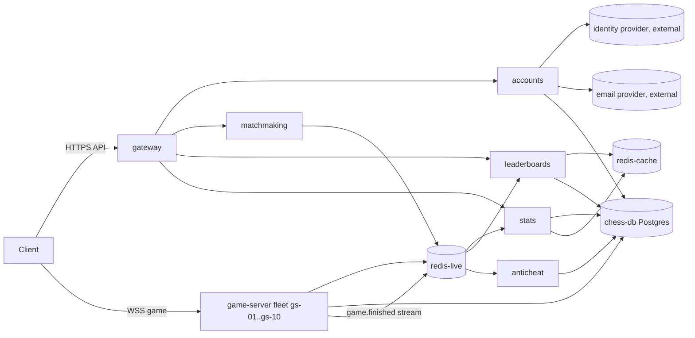

# System card: Fianchetto, an online chess platform (fictional)

**Status:** draft by Claude; owner reviewed sections 1-12 and confirmed the numbers are plausible (2026-10-25). This card is the single source of truth that runbooks and
scenarios are written against. Fianchetto is invented; any resemblance to a real company is unintended. Hosts use
the reserved `.example` domain.

## 1. Product
Players sign up, queue for a live game at a time control (bullet 1+0, blitz 3+2, rapid 10+5), get paired with a
similar-rated opponent, and play on one of our game servers over a WebSocket. Others can spectate live games.
There are no payments and no correspondence chess, so every live game ends within an hour. Clocks are server-authoritative. Finished games update
ratings (Glicko-2), leaderboards and player stats, and are screened by anticheat. A weekly arena tournament
(Fridays 19:00 UTC) and broadcasts of major over-the-board events drive traffic spikes.

## 2. How a game happens
1. **Login:** the client calls `gateway`, which forwards to `accounts`. Accounts checks the password or the external
   identity provider (social login) and returns a signed access token (JWT, 15 min) plus a refresh token.
   The gateway validates JWTs locally with the public key, so play continues if `accounts` is down; only logins fail.
2. **Queue:** the client calls `POST /queue` through the gateway; `matchmaking` adds the player to a Redis queue keyed
   by time control and rating band.
3. **Pairing and allocation:** matchmaking pairs two players, asks the game-server allocator (part of matchmaking)
   for the least-loaded game server on the current version, and returns a signed connection ticket naming that host.
4. **Play:** both clients open a WebSocket directly to `wss://gs-07.play.fianchetto.example`. Each move is validated,
   the clocks updated, the move pushed to the opponent, and the game state checkpointed to `redis-live`.
5. **Game end:** the game server writes the game record (PGN, result, clocks) to `chess-db`, and publishes a
   `game.finished` event to a Redis stream. `stats` updates ratings and stats; `leaderboards` updates its sorted
   sets; `anticheat` queues the game for engine analysis.

## 3. Services
"State" means what is lost or broken if an instance dies or is rolled back. Peak numbers are a normal weekday evening.

| Service | Role | State | Talks to | Runs on | Peak load | Owner |
|---|---|---|---|---|---|---|
| `gateway` | TLS termination, routing, JWT validation, rate limits (per IP and per account) | stateless | accounts, matchmaking, leaderboards, stats | Kubernetes, 8 pods, autoscale to 40 | 3,000 rps | Edge |
| `accounts` | signup, login, social login, tokens, profile | stateless; data in chess-db | chess-db, identity provider, email provider | Kubernetes, 4 pods, autoscale to 12 | 60 logins/s | Edge |
| `matchmaking` | queues, pairing, game-server allocation | stateless; queues live in redis-live | redis-live, game-server registry | Kubernetes, 4 pods, autoscale to 16 | 120 queue joins/s, 60 games started/s | Play |
| `game-server` | hosts live games over WebSocket | **stateful**: live games in memory, checkpointed to redis-live every move | redis-live, chess-db | 10 VMs `gs-01`..`gs-10`, 4,000 games each | 30,000 concurrent games, 6,000 moves/s | Play |
| `leaderboards` | rating ladders per time control | stateless; sorted sets in redis-cache, rebuildable from chess-db | redis-cache, chess-db | Kubernetes, 3 pods | 800 rps | Data |
| `stats` | ratings updates, player stats, game history | stateless; data in chess-db, cache in redis-cache | chess-db (primary and replica), redis-cache | Kubernetes, 4 pods | 400 rps, 60 rating updates/s | Data |
| `anticheat` | engine analysis of finished games, flags accounts | stateless workers; queue in redis-live | redis-live, chess-db | Kubernetes, 20 workers; the heaviest CPU user on the platform | 60 games/s analysed, backlog allowed | Trust & Safety |

**Shared nodes (a known gap):** all Kubernetes services, anticheat included, run on one general node pool (12 nodes).
Anticheat workers have CPU requests but no CPU limits, so a burst of analysis can starve whatever shares their node.

## 4. Data stores (all stateful)
| Store | What | Holds | Limits that matter | If lost |
|---|---|---|---|---|
| `chess-db` | PostgreSQL 16: primary `db-01`, streaming replica `db-02`; PgBouncer in front | users, refresh tokens, game records, ratings, anticheat flags | 500 server connections; PgBouncer pool 300 to primary; per-client caps: game-server 10 per host, accounts 40, stats 60, leaderboards 20, anticheat 40, scheduled jobs 50 | source of truth; restore from backup (RPO 5 min via WAL archive) |
| `redis-live` | Redis cluster, 3 shards with replicas | matchmaking queues, game checkpoints (TTL 2 h), `game.finished` stream, rate-limit counters | 16 GB per shard; maxclients 10,000 | live games cannot recover after a game-server crash; queues are lost (players re-queue) |
| `redis-cache` | Redis, single primary with replica | leaderboard sorted sets, profile and stats cache | 8 GB; eviction allkeys-lru | rebuildable: leaderboards rebuild from chess-db in ~20 min, cache refills on demand; while cold, reads hit chess-db |

## 5. The stateful game servers
- **Allocation:** each server reports its free slots and version to matchmaking every 5 s. Only servers marked
  `accepting` and on the current version get new games.
- **Deploys are by game, not by host:** a new version is installed on one host at a time. A host is first
  *cordoned* (no new games), keeps its running games until they finish, then restarts on the new version. A full
  fleet rollout takes about 90 minutes. Rolling back works the same way, so a bad version keeps serving the games it
  already holds until they end or are moved.
- **Drain time:** a rapid game can last 40 minutes; drains wait up to 45 minutes, then *migrate* the remaining games:
  the client is told to reconnect, another host loads the checkpoint from redis-live, and the clocks resume with a
  grace allowance.
- **Crash:** if a host dies, its games resume on another host from the last checkpoint (at most one move lost) as
  long as redis-live is healthy. If redis-live lost the checkpoint, the game is aborted and not rated.
- **Compatibility:** the checkpoint format is versioned. A version that writes a new format must ship after a version
  that can read it, otherwise a rollback cannot resume migrated games.
- **Connections:** every player and every spectator holds one WebSocket (one file descriptor); `ulimit -n` is 65,536
  per host. A disconnected socket must be closed by the server once its 30 s heartbeat times out.
- **Balancing:** the allocator balances by number of games per host, not by connections or CPU. A popular streamer's
  game can carry thousands of spectators, so one host can run hot while its game count looks normal.
  Spectators per game can be capped live with the config key `spectate.max_per_game` (default: no cap).

## 6. Changes: deploys, config, flags, migrations
- **Deploys** of every service go through the deploy tool and appear in deploy history (`deploys` tool).
  Kubernetes services roll pods out over ~5 minutes; rollback is `deploy rollback <service>` and takes ~5 minutes.
- **Config and feature flags** live in a config repository and are pushed by `cfgpush` to a config agent on each
  host; services reload in under a minute. **Config pushes are not in deploy history**: they show up only in the
  `config-agent` log (`config applied: <key> ... by <user>`). Revert is `cfgpush revert <change-id>`.
- **Schema migrations** run as the `chess-db-migrate` job and are listed in deploy history. They follow
  expand/contract: additive changes ship first, destructive ones only after no running version needs the old shape.
  A migration cannot be rolled back by redeploying a service.

## 7. Scheduled jobs (all UTC)
| Job | When | What | Touches |
|---|---|---|---|
| `ratings-recalc` | daily 02:00 | recompute rating deviation for inactive players | chess-db primary, ~20 min |
| `leaderboard-rebuild` | daily 03:00 | rebuild sorted sets from chess-db | chess-db replica, redis-cache |
| `stats-rollup` | hourly at :15 | aggregate per-player stats | chess-db replica |
| `anticheat-backfill` | ad hoc | re-analyse old games after an engine update | chess-db primary, anticheat workers |
| `db-backup` | daily 01:00 | base backup of chess-db | db-02 |

## 8. Edge, certificates and DNS
| Item | Covers | Renewal | Expiry check |
|---|---|---|---|
| `api.fianchetto.example` cert | gateway | automatic (ACME), every 60 days | monitored |
| `*.play.fianchetto.example` wildcard cert | every game-server host | **manual**: bought yearly and copied to each gs host | not monitored (a known gap) |
| JWT signing key | accounts signs, gateway verifies | rotated every 90 days; gateway must load the new public key first | none |
| identity provider client secret | accounts | yearly, manual | none |

- **DNS:** pods and VMs resolve through internal resolvers `dns-01` and `dns-02`, which forward external names
  upstream. Accounts depends on external names for the identity provider and email provider.

## 9. Traffic and capacity
- Daily cycle: European and American evenings; trough around 08:00 UTC at about 35% of peak.
- The weekly arena multiplies queue joins about 3x for its first 10 minutes. Major broadcasts multiply logins 5-8x.
- When a top streamer goes live, viewers log in, queue and spectate within minutes: logins and queue joins can rise
  4x in 10 minutes, and the streamer's game server carries most of the spectators.
- Limits: gateway autoscales to 40 pods; matchmaking to 16 pods; game-server capacity is 40,000 games (10 hosts
  × 4,000), and a new host takes ~6 minutes to boot and register; the cloud quota allows 14 game-server hosts.
- The gateway returns 429 when a client exceeds its rate limit and 503 when matchmaking has no game-server capacity.

## 10. What responders can observe (what the tools return)
- **Logs:** per service and host (e.g. `gateway-3`, `gs-07`, `db-01`), plus `config-agent` and scheduled-job logs.
- **Metrics:** for every service `request_rate_rps`, `error_rate_pct`, `latency_p99_ms`, `cpu_pct`, `memory_pct`.
  Extras: game-server `active_games`, `open_fds`, `move_latency_p99_ms`; matchmaking `queue_wait_p95_s`;
  chess-db `connections`, `replication_lag_s`; Redis `hit_ratio`, `used_memory_pct`.
- **Deploys:** deploy history, including `chess-db-migrate`; not config pushes.
- **Knowledge base:** this card, the runbooks, and public postmortems.
- **Telemetry pipeline:** a log agent on every host ships logs to the log store; metrics are scraped every 15 s. If
  either stalls, the data for that window is missing (not delayed): gaps show as no data, not as zeros.

## 11. SLOs and on-call
| SLO | Target |
|---|---|
| Move delivery (server receives move → opponent receives it), p99 | < 150 ms |
| Time to start a game after queueing, p95 | < 10 s |
| Login success | 99.9% |
| Games aborted by the platform | < 0.05% |

On-call rotations: **Edge** (gateway, accounts, certificates, DNS), **Play** (matchmaking, game servers),
**Data** (stats, leaderboards, chess-db, Redis, scheduled jobs), **Trust & Safety** (anticheat, business hours only).

## 12. Why stateful vs stateless changes the response
| Action | Stateless service (gateway, accounts, matchmaking, leaderboards, stats, anticheat) | Game servers | Databases |
|---|---|---|---|
| Revert a bad deploy | `deploy rollback`, ~5 min | cordon bad hosts, route new games to the old version, drain or migrate running games; check checkpoint compatibility | not a redeploy: revert a migration only if it was additive; otherwise forward-fix |
| Revert a config push | `cfgpush revert` | same, but takes effect for new games only unless the key is live-reloadable | same, with a DBA |
| Restart | safe one pod at a time | aborts or migrates live games; drain first | failover to replica (Data on-call only) |
| Replace a failed node | Kubernetes reschedules | games resume from checkpoints on other hosts; cordon, replace, register | promote replica; rebuild |
| Scale out | autoscaler or raise its max | boot new hosts (~6 min), quota 14 | not quickly; shed load instead |

## 13. Decisions
- Players connect to game servers directly over WebSocket (needs the wildcard certificate).
- No payments, no correspondence chess.
- Numbers in this card confirmed plausible by the owner.
